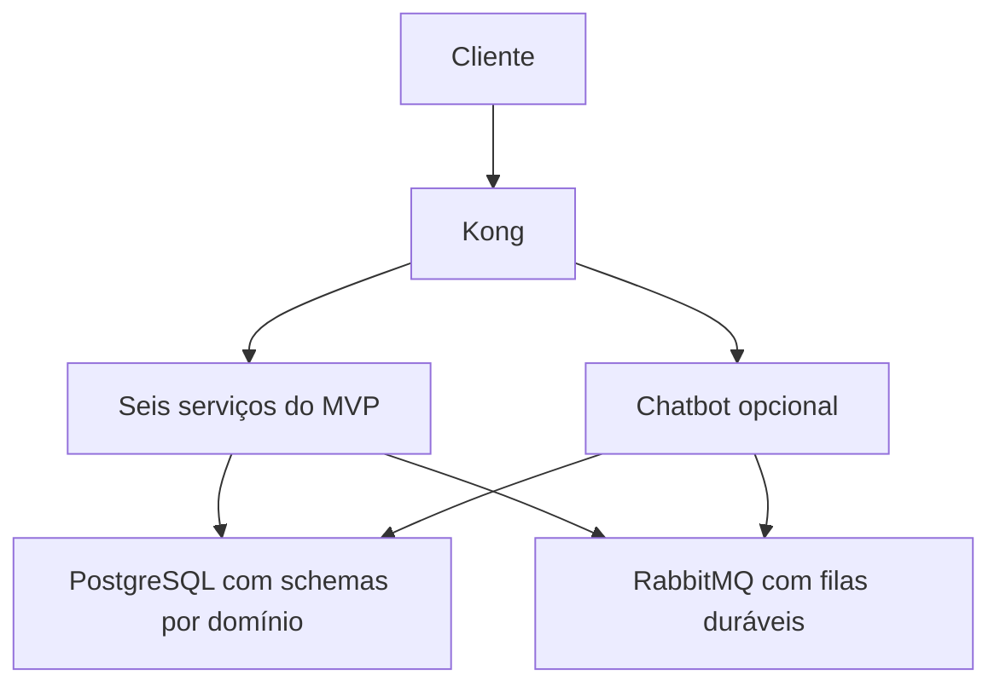

# PassaNorte Backend

Backend em adaptação para o MVP. A matriz de rastreabilidade é a fonte de verdade para requisitos; as decisões explícitas do projeto complementam/substituem os pontos indicados no [plano de implementação](docs/planning/PASSANORTE_IMPLEMENTATION_PLAN.md). O código legado não redefine requisitos.

A S1 estabelece build reproduzível, configuração explícita e segurança de sessões. Não representa a conclusão do MVP. Veja [evidências da S1](docs/implementation/S1.md) e [decisões de segurança e operação](docs/architecture/ADR-001-S1-security.md).

## Estado e arquitetura

Sete processos FastAPI compartilham um banco PostgreSQL 16 com pgvector e um schema por domínio. Só Kong publica uma porta no host, com HTTPS em 8443. RabbitMQ distribui eventos persistentes. As imagens são fixadas por digest e o runtime roda como UID 10001.



[Limites dos sete serviços e ownership](docs/architecture/ADR-002-S2-service-boundaries.md)

[Contrato e migração da S3](docs/implementation/S3_BACKEND.md)

## Primeiro uso local

Pré-requisitos: Docker com Compose v2 e uv. No Windows, inicie Docker Desktop em modo Linux.

A partir da raiz:

```powershell
Copy-Item .env.example .env
uv sync --frozen
uv run --frozen python scripts/generate_secrets.py
docker compose config --quiet
docker compose up --build -d --wait --wait-timeout 180
uv run --frozen python scripts/smoke_s2.py --email admin@example.com
```

Em Linux/macOS use `cp .env.example .env`. O admin padrão de desenvolvimento usa o **email** admin@example.com; sua senha aleatória está no arquivo local `secrets/admin-password`, nunca nos logs. Leia-a privadamente para entrar. O gerador recusa diretório já existente, preservando chaves persistentes.

O script gera arquivos de desenvolvimento; produção deve provisionar os equivalentes via secret manager. Proteja a pasta com ACLs do host. Os arquivos são legíveis pelo UID do contêiner; no Linux a pasta pai privada restringe acesso no host. Não coloque segredos no Dockerfile, argumentos de build, Git, linha de comando ou logs.

`provision` cria papéis e schemas, `migrate` aplica Alembic por serviço, `seed` cria o admin somente se ausente, e a stack inicia os serviços após essas etapas. Um email existente de outro papel ou admin desativado causa falha, sem promoção nem reativação implícita.

Para parar mantendo os dados: `docker compose down`. **Não remova volumes ou regenere chaves para corrigir inicialização.** Credenciais de volumes existentes não são alteradas automaticamente pelo Compose; veja o procedimento de transição no ADR.

## Configuração

`.env` serve à **interpolação do Compose**. O contêiner recebe somente as variáveis declaradas em `environment` e os arquivos montados. O Python não carrega `.env` implicitamente. Para execução fora do Docker, use `uv run --env-file CAMINHO ...` com valores/arquivos próprios do host.

| Variável | Consumidor / política |
| --- | --- |
| APP_ENV | development, test ou production; padrão production. SQLite é permitido apenas em test |
| DATABASE_URL_FILE | Cada serviço recebe seu arquivo; URL postgresql+psycopg obrigatória |
| RABBITMQ_URL_FILE | Todos os serviços; obrigatório fora de test; sem fallback silencioso |
| JWT_PUBLIC_KEYS_DIR | Todos os serviços e Kong; diretório com arquivos KID.pem |
| JWT_PRIVATE_KEY_FILE / JWT_ACTIVE_KID | Somente auth; chave RSA privada correspondente ao KID ativo |
| JWT_ISSUER / JWT_AUDIENCE | Identidade esperada, iguais em todos os verificadores |
| ACCESS_TOKEN_MINUTES / REFRESH_TOKEN_DAYS | Padrões 15 / 7; intervalos aceitos 1–60 / 1–30 |
| PII_ENCRYPTION_KEY_FILE | Somente auth; chave Fernet ou lista ordenada nova,antiga durante rotação |
| PII_HMAC_KEY_FILE | Somente auth; chave independente, pelo menos 32 bytes |
| ADMIN_PASSWORD_FILE | Somente seed; entrada oculta também disponível no CLI interativo |
| DB_CREDENTIAL_DIR | Provisionamento e migrations com arquivo por domínio e papel |
| CATALOG_SERVICE_URL / GAMIFICATION_SERVICE_URL | Endereços privados das APIs internas |
| INTERNAL_API_TOKEN_FILE | Token compartilhado para HTTP interno |
| EDGE_PUBLIC_URL / EDGE_CORS_ORIGIN | URL HTTPS usada no OpenAPI e origem permitida por CORS |
| RABBITMQ_HOSTNAME | Nome estável do nó. Para reutilizar um volume legado do RabbitMQ, preserve o hostname original antes de recriar o contêiner |
| LLM_PROVIDER | chatbot: stub, ollama ou adaptador legado gemini |
| LLM_OLLAMA_URL / LLM_OLLAMA_MODEL | Nomes reais usados pelo adaptador Ollama |
| LLM_GEMINI_API_KEY_FILE | Somente para uso explícito do adaptador legado; não montado por padrão |
| SECRETS_DIR / ADMIN_EMAIL | Interpolação Compose: pasta de segredos e email do bootstrap |

Segredos também aceitam o nome sem `_FILE` para integração com gerenciadores externos. Definir ambos é erro. URLs, chaves e limites são validados; erros de configuração não incluem os valores sensíveis. Chaves não são geradas na inicialização.

## API e autenticação

Em `development` ou `test`, use `https://localhost:8443/docs/{service}` e `https://localhost:8443/openapi/{service}.json`. Confie no certificado de desenvolvimento para o ambiente local. Abra o [Swagger de Identidade](https://localhost:8443/docs/auth), execute `POST /api/v1/session` com **Try it out** e use o `access_token` em **Authorize** para testar `GET /api/v1/me`. O schema usa `EDGE_PUBLIC_URL`. Em produção, Swagger e OpenAPI ficam desabilitados. O perfil `chatbot` habilita a documentação do Chatbot. Kong reserva `/me/balance` e `/me/coupons` para Benefícios.

Rotas principais de identidade sob `https://localhost:8443/api/v1`:

| Método / rota | Contrato |
| --- | --- |
| POST /tourists | Cadastro público com documento validado e aceite versionado |
| POST /session | email/password; retorna access_token, refresh_token, expires_in |
| POST /session/refresh | Corpo {"refresh_token":"..."}; retorna **novo par** |
| DELETE /session | Mesmo corpo; revoga a família da sessão; não exige access válido |
| GET /me | Authorization: Bearer ACCESS_TOKEN |
| PATCH /me | Atualização de perfil autenticado |

Access tokens usam RS256 e exigem assinatura, algoritmo, kid conhecido, exp, iat, sub, iss, aud, type, role e jti. Kong identifica a chave por `kid`; cada serviço repete a validação completa. Um refresh token não autoriza endpoints de negócio. Senhas: mínimo de 8 caracteres no cadastro e máximo de 72 bytes UTF-8, compatível com bcrypt.

O servidor guarda o hash do jti de refresh, usuário, família, expiração e revogação. Rotação é atômica. Reutilizar refresh consumido revoga a família, inclusive os descendentes: clientes devem serializar a renovação e substituir o par armazenado. Logout é idempotente enquanto o refresh apresentado for válido. Access já emitido continua válido até expirar (máximo configurado de 60 min; padrão 15); revogação imediata distribuída não é prometida.

## Desenvolvimento e verificações

```powershell
uv sync --frozen
uv lock --check
uv run --frozen ruff check src tests scripts
uv run --frozen mypy src
uv run --frozen pytest -q
uv run --frozen python scripts/check_secrets.py
uv run --frozen python scripts/smoke_s2.py --email admin@example.com
```

O scanner usa Docker/Gitleaks fixado por digest e analisa a árvore de trabalho visível ao Git (incluindo arquivos novos não ignorados), com achados redigidos. Não certifica o histórico Git nem arquivos locais ignorados. Os testes unitários/contrato usam SQLite e chaves efêmeras geradas exclusivamente nas fixtures; o smoke usa PostgreSQL, RabbitMQ e Kong reais.

A [CI](.github/workflows/ci.yml) executa lock, lint, tipagem, testes, scan, build e smoke. Documentos de serviços antigos podem conter nomenclatura anterior; este README e o plano prevalecem até sua revisão nas respectivas sprints.

Para verificar a recuperação em uma stack de desenvolvimento já iniciada com `.env.example`, execute `bash scripts/verify_s2_recovery.sh`. No PowerShell com Git para Windows, use `& "C:\Program Files\Git\bin\bash.exe" scripts/verify_s2_recovery.sh`. O ensaio interrompe o RabbitMQ, confirma o registro de um evento na outbox durante a interrupção, verifica o reinício automático de Identidade e confirma que o mesmo evento chegou à inbox de Indicadores após a recuperação.

## Migração e reconciliação

Para ensaiar a migração com dados fictícios, execute `bash scripts/verify_s2_migration.sh`. O script usa as revisões históricas da S1, cria um projeto Compose temporário e verifica reversão, aplicação e repetição da migração. Os relatórios JSON saem no terminal e o ambiente temporário é removido no fim.

Restaure cópias congeladas dos sete bancos S1 em um ambiente isolado. Prepare um alvo S2 vazio com `provision` e `migrate`. Importe antes de executar `seed` e preserve as chaves PII que abrem os dados das cópias.

Prepare arquivos privados com DSNs no formato `postgresql://`. No diretório de origem, use os nomes `auth.dsn`, `catalog.dsn`, `gamification.dsn`, `validation.dsn`, `insights.dsn`, `notifications.dsn` e `chatbot.dsn`. O DSN do alvo aponta para o banco `passanorte` isolado, acessado por uma conta de implantação.

```bash
uv run --frozen python scripts/migrate_legacy.py --source-dir /seguro/s1 \
  --target-dsn-file /seguro/s2.dsn --report /seguro/reconciliacao.json
```

O ensaio compara contagens, conteúdo e vínculos e registra a quantidade de contas `employee`. Por padrão a transação é revertida. Para persistir a importação no alvo isolado, use `--commit` e um novo caminho para o relatório. Uma divergência reverte toda a importação.

## Backup, restauração e diagnóstico

```bash
umask 077
docker compose exec -T db pg_dump -U passanorte -C -Fc -d passanorte > passanorte.dump
bash scripts/verify_s2_restore.sh
docker compose exec -T db psql -X -v ON_ERROR_STOP=1 -U passanorte -d passanorte < scripts/verify_s2_privileges.sql
```

O ensaio restaura em um banco temporário do mesmo cluster, compara o snapshot e verifica a separação dos schemas. Em recuperação para um cluster vazio, recrie os papéis do ambiente, preserve chaves e credenciais e restaure o backup com `pg_restore -U passanorte -d postgres --create --exit-on-error`. Após restaurar, execute a verificação de privilégios e o smoke HTTPS antes de direcionar o tráfego.

| Sintoma | Diagnóstico |
| --- | --- |
| Falha na inicialização | Consulte `docker compose ps -a` e `docker compose logs provision migrate seed` |
| Processo responde, mas está indisponível | `/health` indica processo vivo. `/ready` verifica a tabela de entrega e a conexão ao broker |
| Swagger retorna 404 | Confira `APP_ENV`, o nome do serviço e o perfil `chatbot` |
| Certificado recusado | Confira o hostname de `EDGE_PUBLIC_URL` e passe a CA ao smoke com `--ca` |
| Evento pendente | Consulte a outbox e os logs `outbox_retry` |
| Evento na DLQ | Identifique tipo, versão e `event_id`. Preserve o ID e o correlation ID em eventual reenvio |
